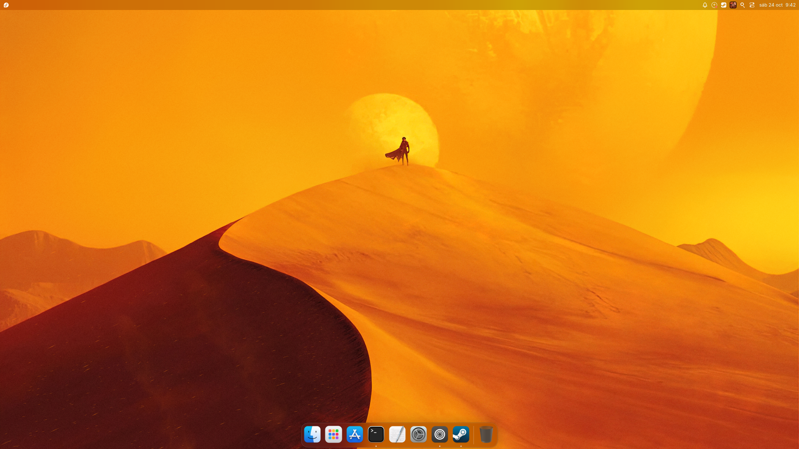
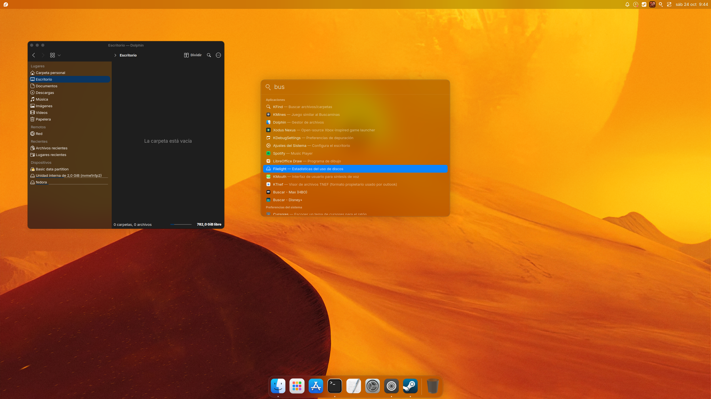
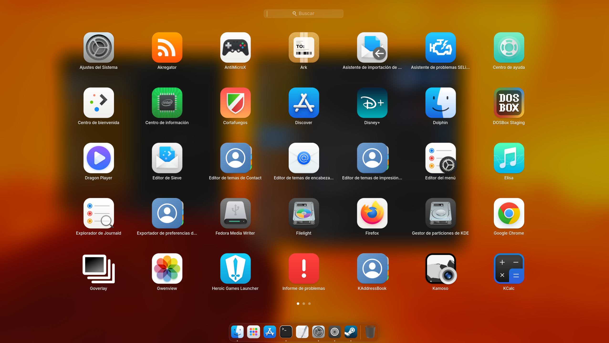
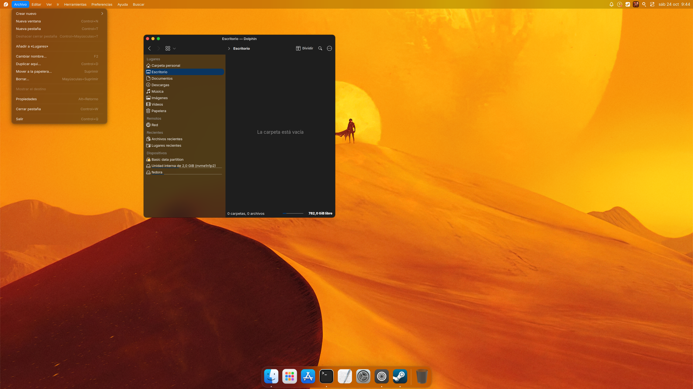
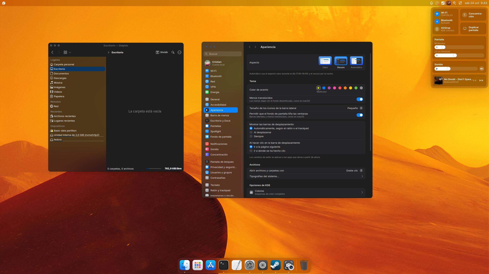

# ArekOS (Vitrum KDE)

[English](README.md) | **Español**

Entorno de escritorio de alto rendimiento para **KDE Plasma 6 (Wayland)**, con diseño e ingeniería inspirados en la estética moderna de macOS. Diseñado para instalarse 100 % en el espacio de usuario (`$HOME/.local` y `$HOME/.config`), sin tocar paquetes del sistema ni requerir permisos de administrador (`root`).



---

## 🌟 Resumen de Características Implementadas

| Componente | Descripción |
|---|---|
| **Dock Vitrum con Blur Avanzado** | Dock flotante con esquina continua (*squircle*), ampliación cosenoidal fluida al pasar el cursor, vista previa de ventanas en vivo vía PipeWire, soporte multi-instancia y auto-ocultación inteligente. |
| **Efecto Desenfoque KWin (`vitrumblur`)** | Motor de desenfoque propio con máscara SDF de esquina continua (*superelipse* $p=2.8$), corrección de espacio de color (`vitrumcolor.glsl`) adaptada a sRGB y luz lineal/PQ para pantallas HDR, y guardián automático ante actualizaciones de KWin. |
| **Spotlight Integrado** | Búsqueda global flotante centrada con Milou/KRunner integrado dentro del mismo proceso y atajos rápidos (`Super + Espacio` / `Alt + Espacio`). |
| **Launchpad de Aplicaciones** | Cuadrícula de aplicaciones a pantalla completa con navegación por páginas, filtro instantáneo y lanzamiento rápido. |
| **Barra Superior & Centro de Control** | Menú global con logo del sistema, menú de aplicaciones, fecha/reloj en tipografía Inter, bandeja minimalista y Centro de Control con deslizadores y accesos rápidos de conectividad. |
| **Ajustes del Sistema & Esquinas Activas** | Aplicación nativa de configuración con estética unificada y modal de **Esquinas Activas** (*Hot Corners*) para disparar Mission Control, escritorio o bloqueo de pantalla. |
| **Pantallas de Bloqueo y Login** | Pantalla de bloqueo nativa en KWin con hora vibrante y píldora de contraseña, más pantalla de inicio de sesión sobre Plasma Login con conmutación de seguridad hacia la pantalla original ante fallos. |
| **Fondos Dinámicos & Waywallen** | Integración nativa con Wallpaper Engine (vía Flatpak waywallen) para fondos animados por monitor y sincronización con el bloqueo. |
| **Integraciones de Apps (Steam & Zen)** | Adaptación automática con controles macOS a la izquierda, esquinas redondeadas de 10 px y sombra integrada sin barras redundantes. |

---

## 🔬 Ingeniería Destacada: El Desenfoque del Dock y Materiales (`vitrumblur`)

Uno de los mayores retos en Linux/KWin es lograr el desenfoque vibrante y suave de macOS sin generar esquinas pixeladas ("en escalera") ni artefactos en pantallas modernas:

1. **Recorte Analítico con Distancia con Signo (SDF):**  
   KWin por defecto recorta las regiones de desenfoque usando rectángulos de píxeles enteros. En `vitrumblur`, las superficies declaran su curvatura en el título de la ventana (`#r19`), y el shader aplica un cálculo de **superelipse continua ($p=2.8$)** con antialiasing por subpíxel, logrando la famosa esquina *squircle* continua de macOS.
2. **Espacio de Color Adaptativo para HDR (`vitrumcolor.glsl`):**  
   En pantallas HDR, la composición en luz lineal aclaraba excesivamente las transparencias (generando un efecto blancuzco o "lechoso"). Desarrollamos un shader que decodifica la luminancia hacia un espacio gamma 2.2 relativo al blanco de referencia, aplica la matriz de tinte y contraste, y re-codifica hacia la transferencia de la pantalla (sRGB, PQ o BT.1886).
3. **Guardián de Actualizaciones:**  
   Al actualizarse KWin, los plugins C++ externos suelen quedar obsoletos. Se incluye un servicio systemd (`vitrum-desenfoque-guardian.sh`) que detecta cambios de versión y recompila automáticamente el efecto en segundo plano al iniciar sesión.

---

## 📸 Galería del Entorno

### Búsqueda Global (Spotlight)


### Lanzador de Aplicaciones (Launchpad)


### Barra Superior y Menús Integrados


### Elementos del Sistema y Ajustes


---

## 🚀 Instalación en 1 línea de comandos

Para aplicar todo en tu usuario actual:

```bash
bash ~/Documentos/ArekOS/install.sh
```

Si clonas el repositorio en cualquier máquina:

```bash
git clone https://github.com/Kuzan-dev/ArekOS.git ~/Documentos/ArekOS && bash ~/Documentos/ArekOS/install.sh
```

### Opciones del instalador

- **`bash install.sh`**: Instalación rápida usando los binarios precompilados (Fedora / KDE Plasma 6). Si detecta una versión distinta de KWin, recompila automáticamente el efecto `vitrumblur`.
- **`bash install.sh --login`**: Instala adicionalmente (requiere `sudo`) la pantalla de inicio de sesión sobre Plasma Login en `/usr/local` y `/etc`, con mecanismo de seguridad que vuelve a la de Fedora si algo falla. Para desinstalarla: `sudo vitrum-login-restaurar`.
- **`bash install.sh --waywallen`**: Instala y activa los fondos animados de Wallpaper Engine con [waywallen](https://github.com/waywallen/waywallen).
- **`bash install.sh --compilar`**: Recompila desde código fuente todos los componentes C++/Qt6/KWin (`vitrum-ajustes`, `org.vitrum.decoracion.so`, `darkly6.so` y `vitrumblur.so`) dentro de un contenedor Podman aislado.

> **Nota tras la primera instalación:** Al finalizar `install.sh`, **cierra sesión y vuelve a iniciar sesión** para que el compositor `kwin_wayland` tome las variables de entorno (`QT_PLUGIN_PATH` y `LD_LIBRARY_PATH`) y cargue la decoración de semáforos y el efecto `vitrumblur`.

---

## 🛡️ Compatibilidad y estabilidad

Probado en **Fedora 44 con GPU AMD** (Radeon RX 5700, `amdgpu`), KWin/kdecoration **6.7.5** y Qt **6.11**. Los binarios de `binarios/` están compilados para esas versiones.

- **GPU AMD / Intel:** el ajuste `KWIN_DRM_USE_COLOR_PIPELINE=0` (evita un crash de KWin 6.6.4 con NVIDIA) solo se aplica si se detecta NVIDIA; en AMD/Intel el color pipeline queda activo (HDR y gestión de color por hardware).
- **Actualizaciones de Fedora (lo más importante):** la decoración de ventanas (`org.vitrum.decoracion`) y Darkly están compilados para una versión concreta de kdecoration y Qt. El guardián `vitrum-plugins-guardian.sh` lo comprueba en cada inicio de sesión: si Fedora los actualiza a otra versión (p. ej. 6.7 → 6.8), pasa a Breeze para que KWin no se caiga, y restaura los de Vitrum cuando vuelven a coincidir. Tras cada actualización grande de KDE conviene ejecutar `bash install.sh --compilar` y cerrar sesión.
- **Desenfoque propio (`vitrumblur`):** su parche (`kwin-desenfoque/herramientas/parchear.py`) **aún no soporta KWin 6.7** (KWin cambió `QRectF` por `RectF`, quitó los shaders `_core` y modificó `blur.h`), así que se usa el desenfoque estándar de KDE, que es estable. El servicio de recompilación lo intenta **una sola vez por versión de KWin** y, si falla, no lo reintenta en cada inicio de sesión (se reintenta al cambiar KWin, con `vitrum-desenfoque-construir --forzar` o con `install.sh --compilar`).
- **Cerrar sesión tras instalar:** KWin solo carga la decoración y los efectos de `~/.local/lib64` si arranca con el entorno que deja el instalador. Sin volver a entrar, las ventanas siguen con la decoración estándar.
- **Navegadores Chromium (Brave, Chrome, Vivaldi) y algunas apps Electron** dibujan su propia barra de título y no muestran los semáforos. En Brave: `brave://settings/appearance` → «Usar barra de título y bordes del sistema».
- **`LD_LIBRARY_PATH=$HOME/.local/lib64`** se aplica a toda la sesión: no pongas otras bibliotecas en esa carpeta.
- **KRunner queda desactivado** (Alt+Espacio y Super+Espacio abren Spotlight).
- **No hay desinstalador:** solo se guardan copias de `plasma-org.kde.plasma.desktop-appletsrc` y `kglobalshortcutsrc` (`*.antes-arekos`). Antes de instalarlo en tu usuario principal, respalda `~/.config` y `~/.local/share`, y pruébalo primero en un usuario de pruebas.
- **No uses `--login` en otra versión de Plasma Login:** toca `/etc` y se omite sola si la versión no coincide.

---

## ⌨️ Atajos de Teclado

Se conservan intactos los atajos estándar de Linux y PC (`Ctrl+C`, `Ctrl+V`, `Alt+Tab`, etc.), asignando las experiencias rápidas a la tecla `Super` (`Meta`):

- **`Super` (sola):** Launchpad (rejilla de aplicaciones)
- **`Super + Espacio` / `Alt + Espacio` / `Super + S`:** Spotlight (búsqueda global)
- **`Super + Tab` / `Super + W`:** Mission Control (vista general de ventanas KWin)
- **`Super + A`:** Centro de Control
- **`Super + N`:** Centro de Notificaciones
- **`Super + Y`:** Vista previa rápida del archivo seleccionado en Dolphin

---

## 🛠️ Desarrollo y Despliegue Rápido (`desplegar-ajustes`)

Para realizar pruebas o desarrollar componentes sin reinstalar todo el entorno:

```bash
# Desplegar cambios en tu sesión actual:
./scripts/desplegar-ajustes

# Desplegar y recompilar la app de Ajustes en tu sesión:
./scripts/desplegar-ajustes --compilar

# Desplegar en un usuario de pruebas aislado (ej: 'vitrum'):
./scripts/desplegar-ajustes --usuario vitrum
```

---

## 🐧 Adaptación para CachyOS / Arch Linux (Guía de portabilidad)

ArekOS fue desarrollado y probado inicialmente sobre **Fedora con KDE Plasma 6 (Wayland)**. La gran mayoría de los componentes (plasmoides QML, temas de Plasma, iconos WhiteSur, atajos y scripts KConfig) son 100 % compatibles con cualquier distribución que use Plasma 6.

Si deseas utilizar o adaptar este entorno en **CachyOS** o cualquier derivada de **Arch Linux**, ten en cuenta:

1. **Compilación nativa en lugar de binarios precompilados:**  
   En CachyOS (rolling release), los plugins C++ deben compilarse nativamente con las dependencias del sistema:
   ```bash
   sudo pacman -S --needed cmake extra-cmake-modules gcc git base-devel \
       qt6-base qt6-declarative kwin kdecoration kf6-kservice kf6-kcmutils \
       kf6-kcoreaddons kf6-kcolorscheme kf6-kguiaddons kf6-ki18n kf6-kiconthemes \
       kf6-frameworkintegration kirigami libepoxy wayland libxcb libdrm \
       mesa libxkbcommon pipewire lcms2 libdisplay-info zstd
   ```
2. **Detección de versiones:** En `install.sh`, sustituir `rpm -q kwin` por `pacman -Q kwin`.
3. **Ruta de plugins Qt6:** Añadir tanto `lib` como `lib64` a `QT_PLUGIN_PATH`:
   ```bash
   QT_PLUGIN_PATH="$HOME/.local/lib/qt6/plugins:$HOME/.local/lib64/qt6/plugins:${QT_PLUGIN_PATH:-}"
   ```
4. **Pantalla de inicio de sesión:** CachyOS utiliza **SDDM** por defecto, por lo que no debe ejecutarse `install.sh --login` (la pantalla de bloqueo `bloqueo/`, en cambio, sí es 100 % compatible).

---

## ⚖️ Aviso Legal / Disclaimer

Este es un proyecto independiente de código abierto para la comunidad de software libre y usuarios de **KDE Plasma**. No está afiliado, patrocinado, respaldado ni asociado de ninguna manera con **Apple Inc.**

Todas las marcas registradas, nombres de productos y logotipos comerciales (incluyendo *Apple*, *macOS*, *Sequoia* y *Monterey*) son propiedad exclusiva de sus respectivos dueños y se mencionan únicamente con fines descriptivos e ilustrativos de referencia estética.
